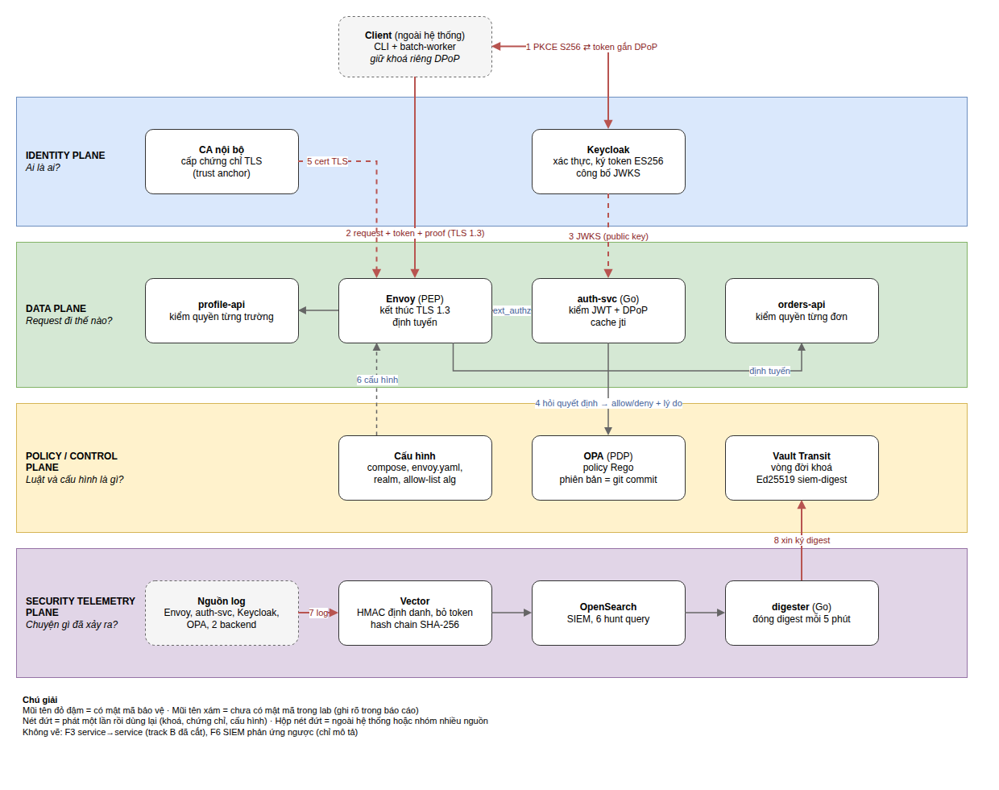
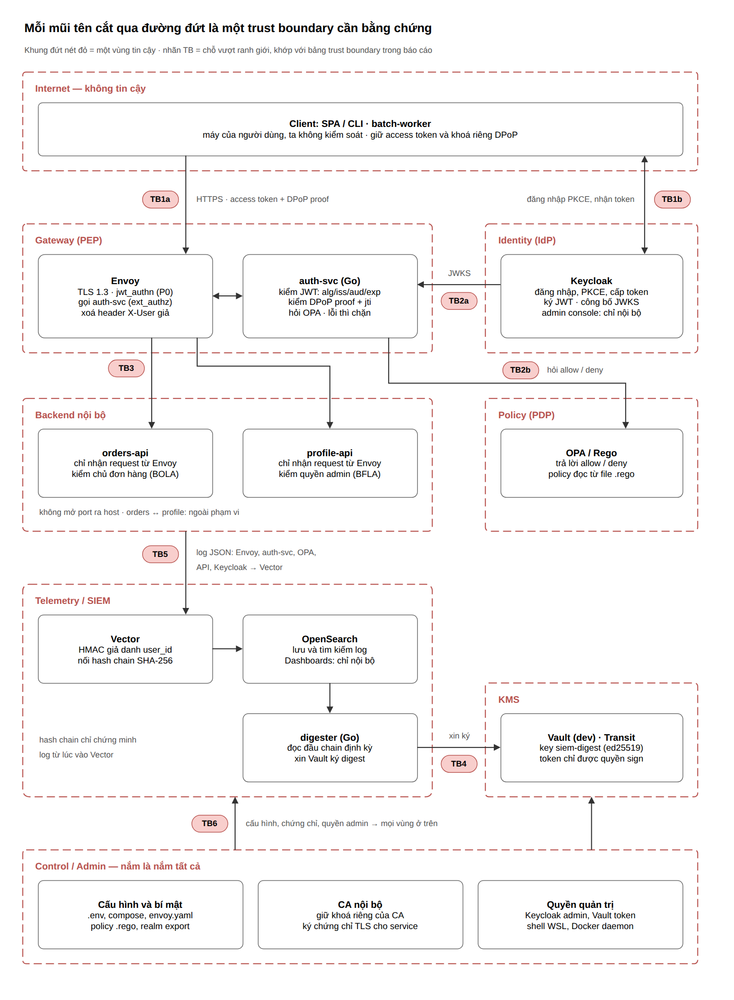

# Phân tích kiến trúc — Topic 09: Cloud API Gateway + SIEM có bảo đảm mật mã

Mốc M1 (cập nhật 2026-10-31, sau tuần 6). Sơ đồ nguồn trong `architecture/`:
`so-do-4-plane.drawio`, `trust-boundary.drawio`, `data-flow-F0-F6.drawio` (kèm ảnh `.png`).
Tài liệu này giải thích **vì sao** kiến trúc như vậy; bằng chứng kiểm thử nằm ở `docs/evidence/`
và `docs/traces/`.

## 1. Mục tiêu và phạm vi

Mức Đại học (đề bài mục 18), làm một mình, 12 tuần. Chọn ba track:

| Track | Nội dung | Trong lab |
|---|---|---|
| **A** — north–south API access | client → gateway: OIDC, PKCE, JWT chặt, sender-constrained token | Keycloak + Envoy + auth-svc (DPoP) |
| **C** — fine-grained authorization | PEP/PDP, RBAC + ABAC, object/property-level ở backend | OPA + 2 backend |
| **E** — SIEM cryptographic evidence | telemetry có toàn vẹn và nguồn gốc | Vector → OpenSearch, hash chain, digest ký bằng Vault (tuần 8–10) |

**Không làm:** track B (east-west mTLS / workload identity — xem §8.2), D (HTTP Message
Signatures, SR-07), F. Phần không làm được viết thành rủi ro còn lại (§9).

Lab chạy Docker Compose trong WSL2 (không Kubernetes): đủ cho "1 gateway + IdP + PDP + 2 services +
SIEM" của mức Đại học, nhẹ máy, và mọi ranh giới mạng vẫn thể hiện được bằng Docker network.

## 2. Bốn plane

| Plane | Câu hỏi | Thành phần | Trạng thái |
|---|---|---|---|
| Identity | Ai là ai? | Keycloak 26.8.0 (IdP, ký token, công bố JWKS); CA nội bộ (cert TLS cho Envoy) | xong (tuần 3–4) |
| Data | Request đi thế nào? | Envoy 1.39.4 (PEP, kết thúc TLS 1.3); auth-svc Go (PEP: JWT, DPoP, hỏi OPA); orders-api, profile-api | xong tới DPoP (tuần 6); object-level ở tuần 7 |
| Policy / Control | Luật và cấu hình là gì? | OPA 1.21.4 (PDP, Rego); file cấu hình (compose, envoy.yaml, realm, policy); Vault Transit (khoá ký digest) | OPA xong (tuần 5); Vault tuần 9 |
| Security telemetry | Chuyện gì đã xảy ra? | log JSON của mọi thành phần → Vector (HMAC định danh, xoá token, hash chain) → OpenSearch; digester ký digest định kỳ | tuần 8–10 |

Ghi chú: ô Keycloak trong sơ đồ ghi "ký token ES256"; cấu hình thật ký **RS256**
(`defaultSignatureAlgorithm`, token thật có `alg: RS256`). ES256 dùng cho `private_key_jwt` của
batch-worker và cho DPoP proof. Sơ đồ sẽ được sửa cho khớp.

### Phân vai AuthN / AuthZ / object-level (checklist mục 22)

| Lớp | Câu hỏi | Ai làm | Ví dụ |
|---|---|---|---|
| Xác thực (AuthN) | token có thật, còn hạn, đúng người nhận, đúng người gửi? | Envoy `jwt_authn` + auth-svc (JWT chặt, DPoP) | chữ ký, `iss`/`aud`/`exp`/`typ`, `cnf.jkt` + proof |
| Phân quyền chức năng | role/thuộc tính này có được gọi route + method này? | OPA (PDP), auth-svc thi hành | `DELETE /orders/{id}` chỉ manager; `POST /orders` chỉ `dept=sales` |
| Phân quyền đối tượng / thuộc tính | đơn hàng 123 có phải của người gọi? trường `salary_band` có được xem? | backend (tuần 7) | `owner_id`, `salary_band` chỉ HR |

Gateway **không** quyết định được lớp thứ ba vì không biết đơn hàng 123 thuộc ai — đó là lý do
đề bài yêu cầu fixture object-level ở backend, không chỉ kiểm scope ở gateway.

## 3. Tài sản cần bảo vệ (đề bài mục 4)

19 tài sản; nhóm quan trọng nhất cho phân tích:

| Nhóm | Tài sản | Phân loại | Bảo vệ chính |
|---|---|---|---|
| Khoá ký | #1 khoá ký token (Keycloak), #13 khoá ký digest (Vault) | Tối mật | #1: khoá phần mềm trong volume (§8.1); #13: không export khỏi Vault, token quyền hẹp |
| Khoá client | #3 khoá `private_key_jwt` của batch-worker, #9 khoá DPoP | Tối mật / Mật | chỉ ở máy client; server chỉ giữ khoá công khai |
| Token & mã | #5 mã uỷ quyền + `code_verifier`, #6 access token, #8 refresh token | Mật | sống ngắn (code 60 s, token 300 s), PKCE, DPoP, refresh xoay vòng + gắn khoá |
| Hạ tầng tin cậy | #10 CA nội bộ, #11 khoá TLS Envoy, #12 JWKS (cần toàn vẹn) | Tối mật / Công khai | `secrets/` quyền 700, không commit; URL JWKS ghim cứng |
| Luật & cấu hình | #15 policy Rego, #16 cấu hình | Nội bộ | git, mount chỉ đọc, `policy_version` trong log |
| Dữ liệu | #17 đơn hàng, #18 hồ sơ (`salary_band`), #19 log + hash chain | Nội bộ / Mật | backend tự kiểm quyền; SIEM không chứa token, định danh băm HMAC |

## 4. Trust boundary

Mỗi mũi tên cắt qua đường đứt là một chỗ một bên phải tin bên kia — cần **bằng chứng** chứ không
chỉ vị trí mạng. Cột "Yếu" là những chỗ lab chấp nhận tin theo vị trí mạng.

| TB | Từ → tới | Bên nhận tin dựa vào | Nếu giả mạo thì sao | Yếu? |
|---|---|---|---|---|
| TB1a | Client → Envoy | TLS 1.3 (cert từ CA nội bộ); chữ ký JWT; P2: DPoP proof | token trộm: P0/P1 dùng được, P2 bị chặn; sửa token → chữ ký sai | |
| TB1b | Client ↔ Keycloak | mật khẩu, PKCE S256, `redirect_uri` khớp tuyệt đối, `state`/`iss`; batch-worker: `private_key_jwt` | chặn được `code` mà thiếu `code_verifier` thì không đổi được token | |
| TB2a | Keycloak → auth-svc (JWKS) | URL JWKS + `iss` ghi cứng; chỉ khoá `use: sig`; cache có TTL | token tự chỉ khoá (`jku`/`jwk`) bị bỏ qua | |
| TB2b | auth-svc → OPA | **chỉ vị trí mạng** (`topic09-policy`, internal, chỉ 2 container) | ai vào được mạng này hỏi/đổi được quyết định | **Yếu** |
| TB3 | Envoy → backend | **chỉ vị trí mạng**; Envoy xoá `X-User` client gửi rồi đặt lại | container bị chiếm trong mạng backend giả được `X-User` | **Yếu** (track B) |
| TB4 | digester → Vault | Vault token chỉ có quyền `transit/sign/siem-digest` | token lộ: ký được digest giả, không lấy được khoá | |
| TB5 | service → Vector → OpenSearch | sau Vector: hash chain + digest ký; trước Vector: chỉ mạng | log giả chèn trước Vector không bị phát hiện | **Yếu** |
| TB6 | Control/Admin → mọi container | quyền trên máy WSL, Docker, git | ai có Docker là có tất cả | **Yếu** (giả định máy dev tin cậy) |

## 5. Data flow F0–F6

| F | Đường đi | Qua TB | Bảo vệ mật mã | SR |
|---|---|---|---|---|
| F0 | phân phối khoá/cert: CA → Envoy; Keycloak → JWKS → auth-svc; Vault → `siem-digest`; `.env` → khoá HMAC | TB6, TB2a | ECDSA P-256 (CA, cert), JWKS qua URL ghim | SR-08 |
| F1 | đăng nhập: client ↔ Keycloak (Auth Code + PKCE; Client Credentials + `private_key_jwt`; P2: + DPoP proof) | TB1b | SHA-256 (PKCE), ES256 (client assertion, DPoP), RS256 (token) | SR-01, 03, 10 |
| F2 | gọi API: client → Envoy → auth-svc → (OPA) → backend | TB1a, TB3 | TLS 1.3 (X25519, AES-256-GCM), RS256 (token), ES256 (proof), SHA-256 (`ath`, `jkt`) | SR-01, 02, 04, 06, 11 |
| F3 | service ↔ service | — | **ngoài phạm vi** (track B) | SR-05 |
| F4 | auth-svc ↔ OPA | TB2b | không có (vị trí mạng) | SR-06, 11 |
| F5 | log mọi service + Vault audit → Vector → OpenSearch; digester → Vault | TB5, TB4 | HMAC-SHA256 (giả danh), SHA-256 (hash chain), Ed25519 (digest) | SR-09, 10 |
| F6 | người vận hành → Keycloak / OPA / Envoy (theo runbook) | TB6 | — | SR-12 |

## 6. Ba profile so sánh

| Profile | Cổng | Chuỗi kiểm | Chặn được | Không chặn được |
|---|---|---|---|---|
| **P0** | `:8444` | TLS 1.3 → Envoy `jwt_authn` (chữ ký, `iss`, `aud`, `exp`) | token giả, hết hạn, sai `aud` | alg/`typ` lạ (không allow-list), **mọi lỗi phân quyền**, token bị trộm |
| **P1** | `:8443` | P0 → auth-svc: JWT chặt (allow-list `alg`, `typ`, `crit`, `iat`, kích thước) → OPA (RBAC + ABAC) | thêm: nhầm loại token, BFLA ở mức route, token DPoP gửi như bearer | token bearer bị trộm |
| **P2** | `:8445` | P1 + token gắn khoá (`cnf.jkt`) + DPoP proof mỗi request (12 bước RFC 9449, cache `jti`) + (tuần 9) hash chain + digest ký | thêm: token bị trộm, replay request | kẻ đã có khoá riêng của client |

Bằng chứng: `gateway-p0-*`, `gateway-p1-*`, `authz-opa-p1-*`, `dpop-p2-*` trong `docs/evidence/`.
Ví dụ cùng một token DPoP bị trộm gửi như bearer: P0 → **200**, P1 → 401, P2 → 401.

Triển khai thật chỉ nên mở P2. P0 và P1 được giữ chạy song song **chỉ để đo so sánh** ở tuần 11
(độ trễ, cycles); để P0 mở cùng P2 thì DPoP bị vượt qua đường P0.

## 7. Các quyết định thiết kế chính

| Quyết định | Lý do | Đánh đổi |
|---|---|---|
| Envoy + ext_authz gRPC tới auth-svc viết bằng Go | Envoy là proxy chuẩn ngành; logic kiểm tự viết thì mỗi bước kiểm nhìn thấy được và giải thích được trong báo cáo | tự viết = phải tự test kỹ (173 unit test) |
| Bộ kiểm JWT/DPoP chỉ dùng `crypto/*` chuẩn của Go, không thư viện JWT | tránh lỗi kinh điển của thư viện (alg confusion, `jku`), thứ tự kiểm do mình quyết | nhiều code hơn |
| Kiểm rẻ trước, đắt sau | chống tiêu tốn CPU bằng token/proof rác (T10): kích thước → `alg` → `kid` → chữ ký → claim; với DPoP, so `jkt` với `cnf.jkt` trước khi kiểm chữ ký | thứ tự khác thứ tự đánh số trong RFC (RFC không bắt buộc thứ tự) |
| Fail closed hai lớp | Envoy `failure_mode_allow: false` (auth-svc hỏng → 403); auth-svc coi mọi lỗi khi hỏi OPA — kể cả `200 {}` — là từ chối (503) | OPA hỏng = API ngừng; chấp nhận vì an toàn hơn sẵn sàng (SR-11) |
| OPA không mở port, mạng riêng chỉ chung với auth-svc | REST API của OPA mặc định không xác thực | TB2b vẫn chỉ dựa vào mạng |
| Profile do Envoy gắn (`context_extensions`), thiếu/lạ → từ chối | client không tự chọn được profile yếu hơn | — |
| DPoP: cửa sổ `iat` ±30 s, cache `jti` trong bộ nhớ có trần, ghi `jti` sau khi mọi bước qua, đầy thì từ chối | đủ chống replay cho một bản auth-svc; không cần Redis | mất cache khi restart; DoS bằng cách làm đầy cache (§9) |
| Client DPoP riêng (`web-app-dpop`) | giữ token bearer cho P0/P1 để so sánh | hai client cùng redirect URI |
| Realm-as-code + script áp một client qua Admin REST | tái lập được trên máy sạch, không phải xoá realm khi thêm client | hai đường cấu hình phải khớp nhau (script đọc từ chính file realm) |
| Ghim phiên bản image (Keycloak 26.8.0, Envoy 1.39.4, OPA 1.21.4, distroless) | tái lập được; chọn bản vá mới nhất của dòng ổn định, không lấy bản vừa ra | phải tự theo dõi bản vá |

## 8. Ba giải thích bắt buộc (checklist mục 22)

### 8.1. Khoá ký token của Keycloak là khoá phần mềm — threat justification (T7)

Checklist: *"Private keys ở KMS/HSM/Vault hoặc có threat justification nếu lab software key."*

- **Thực tế:** khoá RSA ký access token do Keycloak sinh, lưu trong DB H2 ở volume
  `keycloak-data`. Vault Transit chỉ dùng cho khoá ký digest SIEM (tài sản #13).
- **Vì sao chấp nhận trong lab:** Keycloak không hỗ trợ ký token bằng Vault Transit mà không viết
  SPI riêng — ngoài sức một người trong 12 tuần. Đổi sang khoá trong HSM/KMS không đổi kiến trúc
  gateway (gateway chỉ cần JWKS), nên không ảnh hưởng tới phép đo của đề tài.
- **Ai lấy được khoá:** người có quyền trên Docker/volume hoặc admin Keycloak — tức đã vượt TB6,
  lúc đó họ đã kiểm soát mọi thành phần khác.
- **Giảm thiểu đang có:** admin console chỉ mở `127.0.0.1`; khoá có `kid`, gateway có JWKS cache +
  xoay khoá (kid lạ thì tải lại, giới hạn tần suất) nên thay khoá không làm gián đoạn; token sống
  300 s; P2 còn đòi DPoP proof — có khoá ký realm vẫn cần khoá của client để dùng token ở P2
  (trừ khi kẻ tấn công tự cấp token có `cnf.jkt` trỏ tới khoá của chính mình).
- **Rủi ro còn lại:** khoá realm lộ → giả được mọi token ở P0/P1, và ở P2 nếu tự cấp `cnf`.
  Môi trường thật: dùng khoá trong HSM/KMS của nhà cung cấp IdP, xoay định kỳ.

### 8.2. Giới hạn phạm vi track B — không có mTLS/SPIFFE east-west

Checklist: *"mTLS/workload identity được đánh giá cho east-west hoặc scope limitation được ghi rõ."*

- **Không làm:** mTLS giữa Envoy ↔ backend, auth-svc ↔ OPA, service ↔ service; không SPIFFE/SPIRE.
  Không có luồng service ↔ service (F3), và threat T6 (service identity abuse) bị bỏ.
- **Thay bằng:** cô lập mạng Docker — `topic09-backend`, `topic09-authz`, `topic09-policy` đều
  `internal: true`, không publish port (smoke test kiểm tự động); Envoy là thành phần duy nhất nối
  phía client với phía backend; Envoy xoá header danh tính client gửi rồi mới đặt `X-User`;
  backend sẽ tự kiểm quyền đối tượng (tuần 7), không tin hoàn toàn vào gateway.
- **Rủi ro còn lại:** TB2b, TB3 chỉ dựa vào vị trí mạng. Một container bị chiếm trong mạng backend
  gửi được `X-User` bất kỳ; trong mạng policy thì hỏi được OPA trực tiếp.
- **Cách nâng cấp:** mTLS do Envoy làm (cert theo SPIFFE ID cấp bởi SPIRE), backend chỉ nhận kết nối
  từ SPIFFE ID của gateway; hoặc ký `X-User` (JWT nội bộ ngắn hạn) để backend kiểm.

### 8.3. Profile P0/P1/P2 khác mục 12.2 của đề bài

| Đề bài mục 12.2 | Lab | Khác ở đâu |
|---|---|---|
| P0: TLS + bearer JWT + gateway scope check | P0: TLS 1.3 + bearer JWT (`jwt_authn`), **không** kiểm scope | P0 giữ thuần xác thực để làm mốc đo |
| P1: TLS + strict JWT + **DPoP** + OPA | P1: strict JWT + OPA, **chưa** DPoP | DPoP chuyển sang P2 |
| P2: external DPoP + **internal mTLS/SPIFFE** + OPA + KMS + signed/chained SIEM | P2: P1 + DPoP + hash chain + digest ký bằng Vault, **không** mTLS/SPIFFE | bỏ mTLS/SPIFFE (§8.2) |

**Lý do:** mỗi bước P0 → P1 → P2 chỉ thêm **một nhóm cơ chế**, nên chênh lệch đo được ở tuần 11
gán được cho đúng cơ chế đó: P1 − P0 = chi phí JWT chặt + OPA; P2 − P1 = chi phí DPoP (kiểm chữ ký
proof + cache `jti`). Theo đề bài, P1 gộp DPoP với OPA thì không tách được hai chi phí này.

## 9. Bản đồ threat → cơ chế → bằng chứng (tới tuần 6)

| Threat | SR | Cơ chế đã có | Bằng chứng | Còn hở |
|---|---|---|---|---|
| T1 token theft/replay | 04, 10 | P2: DPoP, `cnf.jkt`, cache `jti`, `iat` ±30 s; refresh token gắn khoá | `dpop-p2-2026-10-31.txt` (31/31), `dpop-token-2026-10-31.txt` | P0/P1 (có chủ đích); khoá client bị chiếm; cache mất khi restart |
| T2 JWT validation failure | 02, 08 | allow-list `alg`, ghim `iss` + JWKS, `aud`/`exp`/`nbf`/`typ`, JWKS TTL | `auth-svc-unit-tests-2026-10-31.txt`, `gateway-p{0,1}-*` | khoá realm lộ (§8.1) |
| T3 broken authentication | 03 | PKCE S256, `redirect_uri` chính xác, brute-force detection, `private_key_jwt` | `pkce-negative-*`, `client-credentials-*` | không MFA |
| T4 broken authorization | 06 | OPA: RBAC route+method, ABAC `dept`/`tier`, mặc định từ chối; backend object-level (tuần 7) | `opa-test-2026-10-31.txt` (29/29), `authz-opa-p1-2026-10-31.txt` (24/24) | BOLA chờ tuần 7 |
| T5 gateway bypass | 01, 06 | backend không `ports:`, mạng internal, xoá `X-User` | `smoke-test-2026-10-31.txt` (20/20), `gateway-p1-*` | container bị chiếm trong mạng (§8.2) |
| T7 KMS/key compromise | 08 | (tuần 9) Vault token quyền hẹp, audit device | — | khoá Keycloak phần mềm (§8.1) |
| T8 policy compromise | 06, 11 | policy mount chỉ đọc, `policy_version` trong log, OPA không lộ API, fail closed | `failclosed-2026-10-31.txt` (11/11), smoke test kiểm thành viên mạng policy | ai sửa được git + restart OPA |
| T9 telemetry tampering | 09, 10 | (tuần 8–10) hash chain, digest ký, `verify-chain` | — | log giả trước Vector |
| T10 resource abuse | 11 | kiểm rẻ trước; giới hạn header 16 KiB, token 8 KiB, proof 4 KiB; cache `jti` có trần | unit test, `dpop-p2-*` (C14) | làm đầy cache `jti` bằng token hợp lệ; DoS lớn |
| T11 cloud/admin abuse | 12 | console chỉ `127.0.0.1`, không mật khẩu mặc định, admin events bật | smoke test | ai có Docker là có tất cả |

## 10. Các khác biệt so với chuẩn cần nêu trong báo cáo cuối

- Envoy `jwt_authn` (P0) trả **403** cho lỗi `aud` (ID token, refresh token gửi nhầm), RFC 6750 §3.1
  khuyên 401 `invalid_token`. Vẫn bị chặn, không tới backend.
- Ở P1/P2, token hỏng bị `jwt_authn` chặn trước khi tới auth-svc; giá trị riêng của auth-svc
  (allow-list `alg`, `typ`, `crit`) hiện chứng minh bằng unit test.
- DPoP không dùng `DPoP-Nonce` do server cấp (RFC 9449 §8–9); dựa vào cửa sổ `iat` + cache `jti`.
- Decision log của OPA xoá `input.path` (SR-10); log auth-svc ghi route theo nhóm, không ghi path thật.
